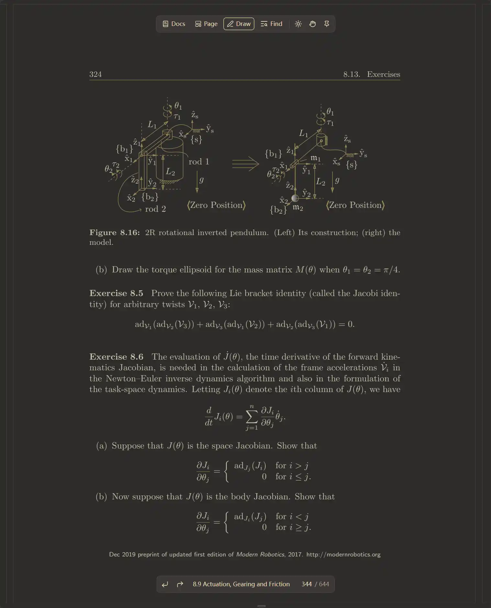
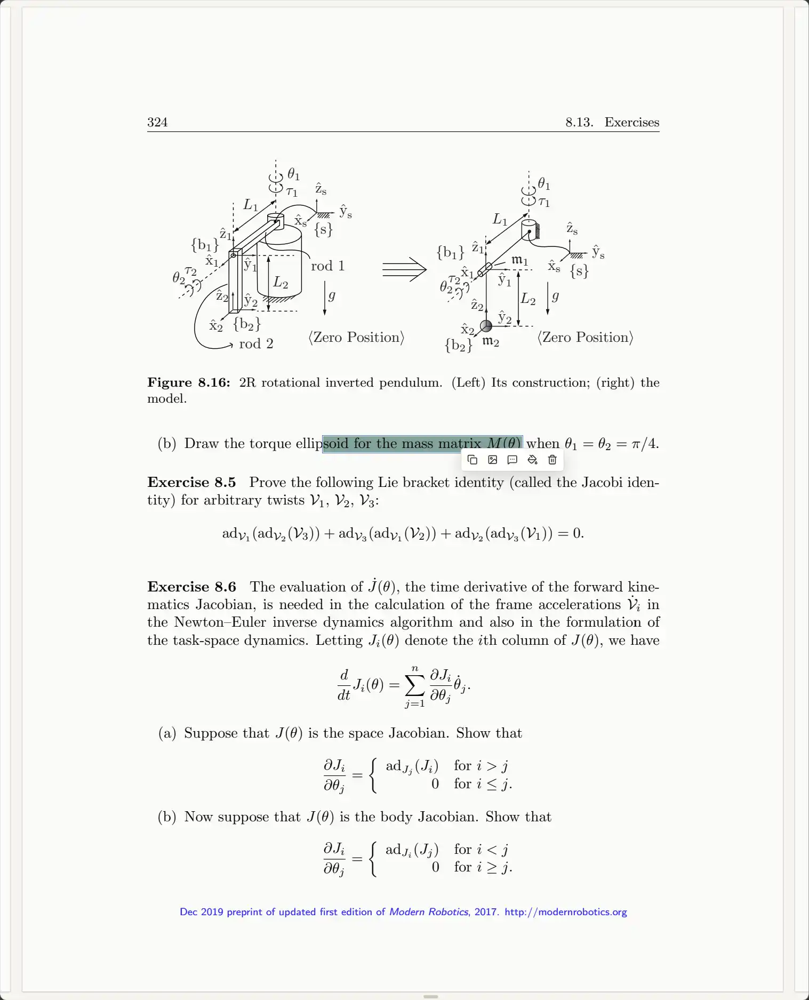

<p align="center">
  
</p>

<h1 align="center">PDF.ts</h1>

<p align="center">A local-first PDF reader and editor powered by EmbedPDF.</p>

[Try it online](https://jay-waves.cn/pdf.ts) · [Download for Linux, Windows, or macOS](https://github.com/jay-waves/pdf.ts/releases)

<table>
  <tr>
    <td align="center"><br>Gruvbox</td>
    <td align="center"><br>Light</td>
  </tr>
</table>

## Features

- Search, outlines, thumbnails, page layouts, zoom, rotation, and reading history.
- Annotations, comments, forms, undo/redo, and PDF export.
- Metadata and digital signature inspection, password protection, and printing.
- Light, dark, Nord, Gruvbox, and Solar themes for the interface and PDF pages.
- Local PDF processing, automatic drafts, and shared edits across supported tabs.
- Optional translation and AI chat through an OpenAI-compatible service.

## Get started

[Download](https://github.com/jay-waves/pdf.ts/releases) a Linux `deb`/`rpm`,
Windows installer, or macOS DMG. On macOS, copy `pdf.ts.app` to `/Applications`.
Packages are unsigned; your OS may require confirmation.

Open a PDF through its file association or the command line:

```sh
pdf.ts open document.pdf
```

Run `pdf.ts` for the welcome screen. In the [web app](https://jay-waves.cn/pdf.ts),
choose or drop a PDF. Supported browsers: Chrome/Edge 152+, Firefox 154+,
Safari/iOS 26+.

For the Chrome extension, [build the ZIP](AGENTS.md#tools-and-packaging), extract
it, and load it unpacked at `chrome://extensions` with Developer mode enabled.

## Saving

**Save to PDF** (`Ctrl+S`) updates the original file on desktop. Browsers write
directly when file-system access is available and permitted; otherwise they
download a copy. External file updates preserve your view and require confirmation
before replacing unsaved edits.

Annotation edits and simple form values are saved as drafts: `original.pdf.swp`
on desktop, private browser storage on the web. Reopening restores a matching
draft; conflicts offer download or discard. Drafts are not backups and do not
modify the PDF. Encrypted PDFs do not create plaintext drafts. Metadata and
security changes require **Save to PDF**.

Supported same-origin tabs share edits and undo/redo for the same file and
revision. Navigation and selection stay independent. Copies and files without
stable identities, including dropped files, remain separate.

The desktop service starts automatically. Use `pdf.ts status` to inspect it,
`pdf.ts stop` to stop it, or `pdf.ts purge` before uninstalling to remove user data.
Uninstalling alone preserves user data.

## Translation and AI

Select text to **Translate** or **Ask**. In **Developer > LLM**, set an
OpenAI-compatible endpoint, model, and API key. The endpoint must allow CORS,
use HTTPS (or localhost HTTP), and support `reasoning_effort: "none"`.
Selected text and conversation messages are sent to that service.
Ask supports streaming and follow-up questions.

In **Developer > Translate**, use `{{selectedText}}` for the selection and
`{{browserDefault}}` for the browser language. With LLM disabled, Translate
opens Google Translate with the selected text.

Keys stay in memory unless **Remember API key in this browser** is enabled,
which stores them unencrypted locally. **Clear key** removes the current page's
key and saved settings; other open pages may retain their in-memory keys.

## Development

See [AGENTS.md](AGENTS.md) for setup, targeted checks, and packaging.

## Architecture

React owns navigation, selection, and presentation. EmbedPDF handles editing and
rendering through PDFium in a worker. A SharedWorker shares document state and
history across supported tabs, with a dedicated worker fallback. Each tab renders
its own view. Platform adapters provide file access, permissions, and persistence
for the browser, Chrome extension, and desktop Go service.

See [terminology](GLOSSARY.md) and the [rendering design](RENDERING.md).
