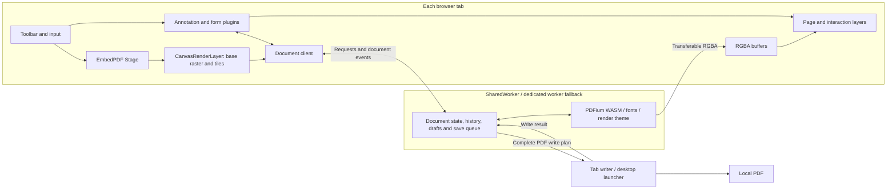

<p align="center">
  
</p>

<h1 align="center">PDF.ts</h1>

<p align="center">A local-first PDF reader and editor powered by EmbedPDF.</p>

[Try it online](https://jay-waves.cn/pdf.ts) · [Download for Linux, Windows, or macOS](https://github.com/jay-waves/pdf.ts/releases)

<table>
  <tr>
    <td align="center"><br>Gruvbox</td>
    <td align="center"><br>Light</td>
  </tr>
</table>

## Features

- **Read comfortably:** search, outlines, thumbnails, flexible page layouts, zoom,
  rotation, and remembered reading progress.
- **Edit and save:** highlight, draw, add text and comments, fill forms, undo/redo,
  and save changes to a PDF or export a copy.
- **Work with documents:** inspect metadata and digital signatures, manage
  password protection, and print selected pages.
- **Theme the page, too:** light, dark, Nord, Gruvbox, and Solar themes adapt
  document colors as well as the interface.
- **Keep work local:** PDF processing runs on your device, with automatic editing
  drafts and shared edits across supported same-origin tabs. Optional AI actions
  send selected text and conversation messages to your chosen service.

## Get started

Install a `deb` or `rpm` on Linux, run the setup executable on Windows, or copy
`pdf.ts.app` from the DMG to `/Applications` on macOS. Desktop packages are
unsigned, so your OS may ask you to confirm that you trust them.

Open a PDF through its file association, or run:

```sh
pdf.ts open document.pdf
```

Running `pdf.ts` alone opens the welcome screen. In the web app, choose or drop a
PDF. For Chrome, build the extension with `pnpm package:chrome` after compiling,
extract the ZIP, and load it through `chrome://extensions` with Developer mode
enabled.

The browser build targets Chrome/Edge 152+, Firefox 154+, Safari/iOS 26+.

## Reading and saving

Use the toolbar for annotations and document tools, and the navigation panels
for search, outlines, and thumbnails. Reading position is remembered when the
document has a stable identity.

**Save to PDF** (`Ctrl+S`) writes your changes to the original file on desktop.
Browser builds save directly when file-system access and permission are available;
otherwise they download a copy. External file updates preserve your view, and
unsaved edits require confirmation before replacement.

Annotation edits and simple form values are saved automatically as drafts:
`original.pdf.swp` beside the PDF on desktop, or in private browser storage on
the web. Draft writes check only the draft version and retain the original PDF
version, without rereading the PDF. External PDF changes do not prevent saving
the current edits as a draft. Reopening restores a matching draft; conflicts let you download or
discard it. Drafts do not change the original PDF and are not backups. Encrypted
PDFs do not create plaintext drafts; metadata and security changes require
**Save to PDF**.

Supported same-origin tabs share edits and undo/redo for the same file and
revision, while keeping navigation and selection independent. Copies and files
without a stable identity, such as dropped files, remain separate.

The desktop background service starts automatically. Use `pdf.ts status` to
inspect it or `pdf.ts stop` to stop it. Uninstalling preserves user data; run
`pdf.ts purge` before uninstalling to remove it.

## Translation and AI

Select text to **Translate** or **Ask**. Configure an OpenAI-compatible endpoint,
model, and API key in **Developer > LLM**. The endpoint must allow browser requests
through CORS, use HTTPS (or HTTP on localhost), and support
`reasoning_effort: "none"`. Ask supports streaming replies and follow-up questions.

Customize translation in **Developer > Translate**: `{{selectedText}}` inserts
the selection and `{{browserDefault}}` uses your browser's preferred language.
When LLM is off, Translate opens Google Translate with the selection instead.

API keys stay in memory unless you enable **Remember API key in this browser**,
which stores the key unencrypted locally. **Clear key** removes it from the
current page and saved settings; other open pages may retain an in-memory copy.

## Development

Requires Node.js 24+ and pnpm 12.

```sh
corepack install --global pnpm@12.3.4
pnpm install
pnpm dev       # Local development; use pnpm dev:wsl for WSL
pnpm check     # Type checking and unit tests
pnpm compile  # Static web app in release/web
```

For installers, run `pnpm package:linux`, `pnpm package:windows`, or
`pnpm package:macos` after compiling. Native builds require Go; Linux packaging
also needs nFPM, Windows needs NSIS and rsrc, and macOS needs Apple Silicon
with Xcode Command Line Tools. Build requirements and module responsibilities
are documented in the relevant source files’ header comments.

### Canvas rendering and regression checks

Page viewing uses raw RGBA → transferable worker buffer → Canvas for both the
base raster and tiles. There is no viewer mode switch or BMP fallback. EmbedPDF's
TileManager and RasterStore own scheduling, deduplication, LRU and retention;
the React layer only paints and reports presentation. Tiles use 768-pixel edges
with 2-pixel bleed. The viewer uses a 32 MiB raster cache, two concurrent tile
requests per render controller, and a 60 ms fixed window that coalesces the newest
demand during motion. This is a tile request limit, not a global Worker byte
budget. Old tiles remain until replacement coverage is presented.
Unmount releases canvas backing stores. Annotation/form image assets and image
exports retain the SDK's encoded-image APIs.

`patches/@embedpdf__plugin-render@3.0.0.patch` adds an opt-in raw transport to the
SDK viewer sources while preserving those export APIs. It also fixes cache byte
accounting, eviction after consumer release, late canceled results, and view
cleanup. The patch is pinned in pnpm; revalidate it when upgrading EmbedPDF.
`tests/render-tiles.test.mjs` tests the installed ESM and CJS implementations,
including buffer identity, request merging, pan reuse, zoom retention and cleanup.
`tests/canvas-painter.test.mjs` asserts tightly packed pixels reach ImageData using
the original buffer. These assertions do not measure browser/GPU allocation:
`putImageData` still copies pixels into the canvas backing store.

With Vite running, use the existing global Playwright and system Chrome:

```sh
node scripts/compare-canvas-rendering.mjs
node scripts/check-canvas-viewer.mjs
node scripts/check-shared-viewer.mjs
```

Set `PDF_TEST_URL` to override `http://127.0.0.1:5173`, and `PDF_BENCH_OUTPUT` to
save benchmark JSON. The benchmark warms both paths, alternates 10 samples per
size, checks exact pixel equality (including rotation/crop), and reports median
worker/RPC and presentation-submission times. It excludes pixel readback, GPU
compositing and RSS; it is not a full-viewer scrolling benchmark. Transfer volume
is almost identical: BMP adds 66 header bytes; the saving is encoding/copying and
image decoding, not compression.

Both modes retain painted tiles during camera motion. Normal mode coalesces the
latest demand in fixed 60 ms windows and continues rendering during motion, with
two concurrent tile requests. Energy saving pauses new work until 120 ms without
camera changes, uses one concurrent request and fixes DPR at 1.25. It has no
additional scheduling delay after settling. Settings diagnostics
refresh every two seconds while the dialog is open. Temporary memory tracing has
been removed. `node scripts/check-energy-motion.mjs` verifies retention and resume
in both modes against the local preview.

## Rendering and Worker pipeline

EmbedPDF 3 manages the viewport and progressive page rendering. A SharedWorker
owns PDFium and shared document state; environments without SharedWorker or Web
Locks fall back to a dedicated worker. Each tab keeps its own rendering cache.
The worker shares a 64 MiB parsed-page cache and a 32 MiB decoded-image cache
across documents. These are cache budgets, not a hard limit on the WASM heap.
After the last document closes and outstanding saves/drafts finish, a 10-second
idle grace period releases the native runtime. Connected tabs retain their ports;
a later open initializes a fresh runtime. Opening during the grace period cancels
teardown. EmbedPDF 3.0's residual page-residency timer is explicitly canceled on
shutdown; revisit this version-specific cleanup on SDK upgrades.

Against Vite dev, `node scripts/check-runtime-idle.mjs` verifies shared-tab
ownership, grace-period reopen, idle destruction and rendering after reinitialization.



