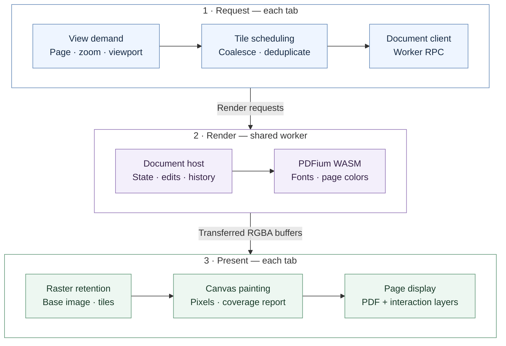

# Rendering design

This is the sole authoritative design document for the rendering pipeline.
Update it with changes to rendering ownership, transport, scheduling, caches,
or runtime lifecycle. Keep local implementation details in code comments.

[User guide](README.md) · [Glossary](GLOSSARY.md) · [Development](AGENTS.md)

## Pipeline

Base rasters and tiles use raw RGBA transferred from the worker to Canvas.
EmbedPDF's TileManager and RasterStore handle scheduling, deduplication, LRU,
and retention; React paints and reports presentation. Annotation/form assets
and image exports use the SDK's encoded-image APIs.

The diagram follows a render request that needs new pixels. Cached rasters stay
in the tab; edits invalidate affected rendering, and Canvas reports presented
coverage before older tiles are released. The request and presentation sections
belong to the same tab. A dedicated worker replaces the shared worker when needed.

Reading history restores after the SDK's document-open action queue settles,
so a PDF's initial destination cannot overwrite the saved reading position.

For files without a recoverable draft, opening does not scan all annotations
and forms for a draft baseline. The worker captures that original-state snapshot
inside its native lane before the first operation outside an explicit read
allowlist. Draft recovery still captures it before applying recovered edits.

Saving is a separate path: the host prepares a complete PDF write plan, the
platform writer writes the file, and its result confirms the saved revision.

## Tiles and motion

Content layers mount immediately for pages with a nonempty visible region;
offscreen candidates from the SDK's scene query keep only their layout shells.
Cached rasters and base requests have no admission or motion delay; only tile
refinement uses the timing policy below. SDK annotation metadata loading still
follows its own stage subscriptions.

After visible base pictures and tile demands are presented, an idle callback
warms one adjacent page's base raster in the reading direction (initially forward).
It uses the ordinary source key and 32 MiB raster cache, without offscreen Canvas,
text, annotation or form layers. The ordinary view priority keeps it behind
visible pages and automatically promotes it when the neighbour enters the viewport.
Camera changes, new foreground tile demand, hidden tabs and teardown cancel
unfinished speculation; a matching in-flight base that becomes visible is handed
to its foreground consumer instead of restarted. Failures are not retried for the
same candidate until the candidate changes; prefetch never adds a wait to
foreground rendering. Kernel notifications coalesce speculative checks to one per
frame; camera changes and cancellation of active speculation remain immediate.

| Setting | Value |
| --- | --- |
| Tile edge / bleed | 768 / 2 pixels |
| Resolution levels | 0.5–128 device pixels per PDF point, spaced by √2 |
| Raster cache | 32 MiB per tab |

### Normal vs. Energy Saving

| Behavior | Normal | Energy Saving |
| --- | --- | --- |
| Priority | Progressive detail during movement | Reduce work for changing viewports |
| During camera motion | Continue scheduling new tiles | Pause new tile work in the reading viewport |
| Timing | Fixed 60 ms demand window; later updates do not restart it | Wait for 120 ms without camera changes; every change restarts the timer |
| Demand selection | Submit the latest demand in each window | Resume with the latest demand after settling |
| Scrollbar release | Flush the latest tile demand immediately | Resume and submit immediately, without the remaining settle wait |
| Concurrent tile requests | 2 per render controller | 1 per render controller |
| Effective DPR | Selected profile; Auto uses `min(system DPR, 1.75)` | Fixed at 1.25, overriding the selected profile |
| Already painted tiles | Retained until replacement coverage is presented | Same; pausing does not clear painted tiles |
| Cache and stale work | SDK cache reuse, deduplication, and obsolete-request cancellation | Same; intermediate viewport requests are not accumulated |
| Mode changes | Reuse the document and raster cache | Same; no document rebuild or cache reset |

The motion gate follows camera events, including wheel scrolling, touch momentum,
scrollbar drags, and navigation. It pauses tile scheduling, not the entire renderer
or base-raster path. Concurrency limits apply per controller, not globally across
workers or tabs. Neither mode changes save or draft behavior.

The Canvas bridge submits only changed demands, using the SDK demand comparator.
Pause/resume and layer changes also submit; motion-end flush shares that same
submission path. SDK invalidation and tile arrivals continue to re-plan internally.

Painted tiles remain during motion until replacement coverage is presented.
Active tiles retain raster references independently of cache eviction, so the
cache budget does not cap active pixels or Canvas memory. Unmounting releases
canvas backing stores.

## Worker lifecycle

The worker has one native operation lane. Pending allowlisted page reads are
ranked using the latest session/view working sets: visible pages before near or
offscreen pages, then base pixels before tiles and auxiliary reads. Equal ranks
stay FIFO. Unknown operations, edits and lifecycle tasks are ordering barriers;
reads cannot cross them. Known document metadata reads share that read group;
page lists, render policy and opening actions precede bulk annotation indexing.
Whole-document annotation reads run in batches of 16 pages and yield between
batches, letting visible pixels and metadata run first. Each continuation keeps
its original queue position relative to edits and lifecycle barriers, so the SDK
receives one complete, consistent annotation snapshot. Cancellation releases the
remaining batches. Small and explicitly page-scoped reads retain their page
ordering and results. Save/draft capture continues through this same lane.
Running work is not forcibly preempted; caller cancellation follows the SDK's
cooperative abort path. Cancelled queued requests are removed before execution.

Working-set hints bypass the operation queue and replace the previous hint
immediately. View IDs are scoped by tab session and cleared on close. The lane
yields an event-loop turn between operations to receive viewport and abort
messages, with no additional debounce window. Offscreen reads that still have
consumers run after higher-priority work; their promises are not discarded.

A SharedWorker owns PDFium and shared document state. Without SharedWorker or
Web Locks, a dedicated worker is used. Tabs keep separate rendering caches.
The worker shares a 64 MiB parsed-page cache and a 32 MiB decoded-image cache
across documents; these budgets do not cap the WASM heap.

After the last document closes and pending saves/drafts finish, a 10-second grace
period precedes native runtime teardown. Reopening cancels teardown; opening
after teardown initializes a new runtime through the existing tab ports.
Shutdown explicitly cancels EmbedPDF 3.1's residual page-residency timer.

Forced-color rendering uses a deadline-based PDFium pause callback and routes
continuations through the SDK's normal slice/yield/abort loop. Render close
clears the themed-page routing on completion or cancellation. Slice budgets
are cooperative, not a hard bound on individual native operations.

## SDK patch

`patches/@embedpdf__plugin-render@3.1.0.patch` adds raw viewer transport while
preserving encoded exports. It fixes cache byte accounting, eviction after
consumer release, late canceled results, and view cleanup. Revalidate the patch
and runtime cleanup when upgrading EmbedPDF.

`tests/render-tiles.test.mjs` covers installed ESM/CJS buffer identity, request
merging, pan reuse, zoom retention, and cleanup. `tests/canvas-painter.test.mjs`
checks that tightly packed pixels reach ImageData in the original buffer.
`putImageData` still copies pixels into the Canvas backing store.

## Copies, ownership, and memory

| Boundary / resource | Expected copy or allocation | Owner and release |
| --- | --- | --- |
| PDFium bitmap → raw result | Native pixel allocation plus a copy into an owned JS buffer | Native render task frees its bitmap and scratch allocations after readback |
| Worker → tab | Transfer the owned RGBA buffer; no structured-clone pixel copy | Sender buffer detaches; tab retains the result |
| Raw buffer → ImageData | Packed RGBA uses a typed-array view; padded stride requires a packed copy | Temporary views/copies become collectible after painting |
| ImageData → Canvas | `putImageData` copies pixels into the backing store | Canvas component zeros its dimensions on unmount; browser controls physical reclamation |
| Raster cache and active tiles | References can share one buffer; do not count them twice | RasterStore evicts reusable entries; active tiles retain pixels until replacement coverage is presented or their view closes |
| View demands and paint callbacks | JS handles, subscriptions, animation frames | Effect cleanup destroys/releases demands and cancels pending presentation callbacks |
| Native document, fonts, page/image caches | WASM allocations and worker-side data | Last document reference closes the document; idle teardown destroys the runtime and cancels its residency timer |
| GPU/compositor surfaces | Browser-dependent upload, staging, and surface copies | Browser-managed; not included in JS heap or raster-cache accounting |

Transfer avoids one boundary copy, not all copies. File opening, encoded-image
exports, and full-PDF serialization can add document-sized buffers outside this
pixel path. A cancelled request can still finish; its late result must not reclaim
a cache slot or retain a closed view.

### Peak-memory model

Approximate peak = worker/WASM memory + each tab's unique live RGBA buffers +
Canvas backing stores + temporary readback/repacking buffers + GPU surfaces +
concurrent open/save/export buffers. Use actual raster dimensions: packed RGBA
costs `4 × width × height` bytes; padded data costs `stride × height`.

| Allocation group | Expected contribution |
| --- | --- |
| Worker | 64 MiB parsed-page and 32 MiB decoded-image cache budgets, plus documents, fonts, render scratch, and allocator overhead; these are neither reserved sizes nor a WASM-heap cap |
| Each tab | 32 MiB reusable raster-cache budget, plus active rasters outside that budget and separate Canvas stores; count overlapping cache/active references once |
| Zoom, rotation, or replacement | Old and new coverage can coexist, temporarily increasing both raster and Canvas memory; staging a replacement also keeps the old document alive |
| DPR and multiple tabs | Pixel memory grows roughly with DPR squared for the same logical area; each tab adds its own rendering memory, while dedicated-worker fallback also duplicates native runtimes |

For scale, a **768 × 768 output raster** is 2.25 MiB, or about 4.5 MiB with
one Canvas copy. Twelve such tiles are about 54 MiB; retaining a full old and new
set is about 108 MiB, before bleed, base rasters, worker memory, and GPU overhead.
This is an illustrative allocation estimate, not a measured RSS limit.

### Trace interpretation

Correlate demand → native render/readback → RPC receipt → Canvas paint → coverage
report with live buffer bytes, tile/view counts, WASM heap, and browser/GPU memory.
Repeated equivalent pan/zoom/open/close cycles should plateau after cache warmup;
growing retained buffers, closed views, listeners, or callbacks indicate a possible
leak. Check again after last-document close and the 10-second idle grace period.
WASM high-water marks and delayed browser reclamation alone do not prove a leak.

The current `sampleRasterPixels` diagnostic counts image elements, not Canvas
backing stores; its display cannot establish current renderer memory usage.

## Measurement limits

`tests/profiling/compare-canvas-rendering.mjs` compares raw RGBA and encoded-image paths: warmup, 10 alternating
samples per size, exact pixel equality including rotation/crop, and median
worker/RPC and presentation-submission times.
It excludes GPU compositing, pixel-readback timing, and RSS; it does not measure
viewer scrolling. BMP adds only 66 bytes to transfer size, so raw transport saves
encoding, copying, and decoding work rather than bandwidth.

`tests/profiling/profile-open.mjs` measures
file drop to the requested page's first painted base Canvas in system Chrome.
It starts with the viewer shell loaded, includes reading-position restoration,
and excludes OS/application launch and final tile refinement. Use
`PDF_BENCH_OUTPUT` to save the per-sample JSON. Timing is diagnostic, not a gate.

`tests/profiling/profile-engine-open.mjs` profiles the installed SDK's open path
and individual WASM calls in a dedicated Chrome worker with an initialized
runtime. It compares normal opening, an isolated signature-protection-probe
bypass, deferred checking, and plain PDFium loading. Additional controls read
forms or revisions before checking to isolate shared work. Deferred checking
refreshes the SDK guard only in the diagnostic; no production permission policy
is changed. These controls are not functionally equivalent viewer implementations. Timings exclude file fetching,
application hashing, layout and painting; nested total times must not be added.
