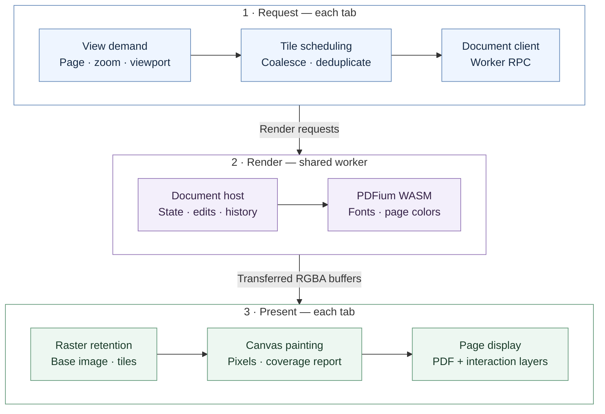

# Rendering design

This is the sole authoritative design document for the rendering pipeline.
Update it with changes to rendering ownership, transport, scheduling, caches,
or runtime lifecycle. Keep local implementation details in code comments.

[User guide](README.md) · [Glossary](GLOSSARY.md) · [Development](AGENTS.md)

## Pipeline

Base rasters and tiles use raw RGBA transferred from the worker to Canvas.
EmbedPDF's TileManager and RasterStore handle scheduling, deduplication, LRU,
and retention; React paints and reports presentation. Annotation/form assets
and image exports use the SDK's encoded-image APIs.

The diagram follows a request for new pixels. Cached rasters stay in the tab;
edits invalidate affected rendering. Request and presentation belong to the
same tab, while the SharedWorker owns PDFium and shared document state. Without
SharedWorker or Web Locks, a dedicated worker is used. Each worker has one native
operation lane; tabs retain separate raster caches.

Saving is a separate path: the host prepares a complete PDF write plan, the
platform writer writes the file, and its result confirms the saved revision.

## Rendering parameters

| Setting | Value |
| --- | --- |
| Tile edge / bleed | 768 / 2 pixels |
| Resolution levels | 0.5–128 device pixels per PDF point, spaced by √2 |
| Raster cache | 32 MiB per tab |
| Parsed-page cache | 64 MiB per worker; adaptive ceiling of 128 MiB |
| Decoded-image cache | Fixed 32 MiB per worker |

Cache budgets guide eviction; they do not cap active pixels or the WASM heap.
See [Copies, ownership, and memory](#copies-ownership-and-memory) for accounting.

## Optimization Q&A

### Q: Why scan an entire document before showing its first page?

A: Opening a file without a recoverable draft skips the annotation/form scan
for a draft baseline. The worker captures the original-state snapshot inside
its native lane before the first operation outside an explicit read allowlist.
Draft recovery still captures the baseline before applying recovered edits.

### Q: Why does a document jump away from its restored reading position?

A: Restore reading history after the SDK's document-open action queue settles,
so the PDF's initial destination cannot overwrite the saved position.

### Q: How do offscreen pages avoid consuming rendering resources?

A: Mount content layers immediately for pages with a nonempty visible region.
Offscreen candidates from the SDK's scene query keep only layout shells. SDK
annotation metadata loading still follows its own stage subscriptions.

### Q: How do scrolling and zooming avoid accumulating obsolete tile work?

A: Apply the following motion policy to tile refinement. Cached rasters and
base requests have no admission or motion delay.

| Behavior | Normal | Energy Saving |
| --- | --- | --- |
| Priority | Progressive detail during movement | Reduce work for changing viewports |
| During camera motion | Continue scheduling new tiles | Pause new tile work in the reading viewport |
| Timing | Fixed 60 ms demand window; later updates do not restart it | Wait for 120 ms without camera changes; every change restarts the timer |
| Demand selection | Submit the latest demand in each window | Resume with the latest demand after settling |
| Scrollbar release | Flush the latest tile demand immediately | Resume and submit immediately, without the remaining settle wait |
| Concurrent tile requests | 2 per render controller | 1 per render controller |
| Effective DPR | Selected profile; Auto uses `min(system DPR, 1.75)` | Fixed at 1.25, overriding the selected profile |
| Cache and stale work | SDK cache reuse, deduplication, and obsolete-request cancellation | Same; intermediate viewport requests are not accumulated |
| Mode changes | Reuse the document and raster cache | Same; no document rebuild or cache reset |

The gate follows all camera events: wheel scrolling, touch momentum, scrollbar
drags and navigation. It pauses tile scheduling, not the entire renderer or
base-raster path. Request limits are per controller, not global across workers
or tabs. Neither mode changes save or draft behavior.

The Canvas bridge uses the SDK demand comparator to submit only changed demands.
Pause/resume and layer changes also submit; motion-end flush uses the same path.
SDK invalidation and tile arrivals continue to re-plan internally.

### Q: How do we avoid blank flashes while replacing tiles?

A: Keep painted tiles until Canvas reports replacement coverage, including
during motion and scheduling pauses. Active tiles retain raster references
independently of cache eviction. Unmounting releases Canvas backing stores.

### Q: Can the next page be ready without slowing the current page?

A: After visible base pictures and tile demands are presented, an idle callback
warms one adjacent page's base raster in the reading direction (initially forward).
It uses the ordinary source key and raster cache, without offscreen Canvas,
text or annotation/form layers. Ordinary view priority keeps it behind visible
pages and promotes it when the neighbour enters the viewport.

Camera changes, new foreground tile demand, hidden tabs and teardown cancel
unfinished speculation. A matching in-flight base that becomes visible passes
to its foreground consumer instead of restarting. A failed candidate is not
retried until the candidate changes; prefetch never delays foreground rendering.
Kernel notifications coalesce speculative checks to one per frame; camera
changes and cancellation of active speculation remain immediate.

### Q: How does a new viewport get ahead of stale queued reads?

A: Rank pending allowlisted page reads using the latest session/view working
sets: visible pages before near or offscreen pages, then base pixels before
tiles and auxiliary reads. Equal ranks stay FIFO. Known document metadata
reads join that read group; page lists, render policy and opening actions
precede bulk annotation indexing.

Working-set hints bypass the queue and replace the previous hint immediately.
View IDs are scoped by tab session and cleared on close. Between operations,
the lane yields an event-loop turn to receive viewport and abort messages,
without another debounce window. Offscreen reads with consumers still complete
after higher-priority work; their promises are not discarded.

Unknown operations, edits and lifecycle tasks remain ordering barriers that
reads cannot cross. Save/draft capture uses the same lane. Running work is not
forcibly preempted: cancellation follows the SDK's cooperative abort path,
while cancelled queued requests are removed before execution.

### Q: How can a full annotation scan avoid blocking visible pixels?

A: Whole-document annotation reads run in batches of 16 pages and yield between
batches. Visible pixels and metadata can run first, but each continuation keeps
its original queue position relative to edits and lifecycle barriers. The SDK
therefore receives one complete, consistent snapshot. Cancellation releases
remaining batches; small and explicitly page-scoped reads retain their ordering
and results.

### Q: How do background tabs stop competing with the active document?

A: Visibility updates bypass the lane. Hidden sessions withdraw their native
working-set hints and rank allowlisted reads below foreground reads, without
crossing barriers or interrupting running work. The latest hints remain in the
session, including updates received while hidden, and restore immediately on
visibility or BFCache return. Another session viewing the same PDF keeps its
own hints.

This changes scheduling and eviction preference. Hiding does not flush cached
pixels, close documents, discard edits/history, or directly resize the budget.

### Q: What if switching between documents repeatedly evicts pages we need again?

A: Grow the parsed-page budget from its base to its ceiling when the same
document/page completes three reloads within 10 seconds, each within 10 seconds
of a budget eviction. Growth does not reopen documents, flush caches or change
pixel quality. Raster and decoded-image budgets remain fixed.

Only budget eviction followed by rapid reloading counts. Cache hits, cold loads,
content invalidation, idle cleanup, failed/incomplete loads and document close
do not. Edits and other non-read jobs conservatively reset pressure history.
History is weakly owned by document and bounded to 256 page entries per document.
Consequently, one-way reading does not grow the budget merely by evicting pages.

### Q: When can the extra cache budget be reclaimed?

A: Initially require 60 seconds without a rapid reload, and parsed-page usage
below 32 MiB, before returning to the base budget. Failed shrinks extend that
wait as described below. Check every 5 seconds. No native eviction runs from
the timer while a worker job is suspended between slices.

The SDK still protects held pages and may retain one oversized page. The ceiling
is an eviction budget, not a hard allocation limit; reducing it does not guarantee
that the browser immediately returns WASM memory to the operating system.

### Q: What if shrinking the cache brings the repeated reloads back?

A: Treat each shrink as a 10-second trial with fresh eviction history. One new
budget eviction followed by a rapid reload during the trial restores the previous
budget immediately, without waiting for three repeats. Double the quiet interval
before trying another shrink: 120, 240, then at most 480 seconds.

A trial that expires without rollback resets the interval to 60 seconds. Cold
loads and invalidations cannot trigger rollback. This feedback remembers failed
shrinks without raising the budget ceiling or retaining old workload penalties
indefinitely. Runtime diagnostics expose current budget, estimated usage, budget
evictions, rapid reloads, tier changes, rollbacks and the quiet interval.

### Q: Why does PDFium remain alive after closing the last document?

A: Once all documents close and pending saves/drafts finish, allow a 10-second
grace period before tearing down the native runtime. Reopening cancels teardown;
opening after teardown initializes a new runtime through the existing tab ports.
Shutdown cancels both the adaptive-budget timer and EmbedPDF 3.1's residual
page-residency timer. An open but inactive document does not qualify for teardown.

### Q: How does forced-color rendering stay responsive and cancellable?

A: Use a deadline-based PDFium pause callback and route continuations through
the SDK's normal slice/yield/abort loop. Render close clears themed-page routing
on completion or cancellation. Slice budgets are cooperative, not hard limits
on individual native operations.

## SDK integration and verification

Revalidate both pinned patches and runtime cleanup when upgrading EmbedPDF:

| Patch | Purpose |
| --- | --- |
| `patches/@embedpdf__engine-services@3.1.0.patch` | Exposes parsed-page cache observations and runtime budget updates in ESM/CJS, distinguishing budget evictions from other releases |
| `patches/@embedpdf__plugin-render@3.1.0.patch` | Adds raw viewer transport while preserving encoded exports; fixes cache byte accounting, eviction after consumer release, late cancelled results and view cleanup |

| Coverage | Evidence |
| --- | --- |
| Adaptive policy | `tests/adaptive-page-cache.test.mjs`: thresholds, trial expiry, rollback, bounded exponential backoff and recovery after successful shrink |
| Native cache behavior | `tests/parsed-page-cache.test.mjs`: actual WASM eviction/reload, reuse, mutation exclusion, promotion and demotion in installed ESM/CJS |
| Multiple documents | The native cache tests compare fixed/adaptive budgets across two/three-document switching, backtracking, zoom, editing and return after idle shrink; pixels match and page loads decrease. One-way reading must not promote |
| Viewer switching | Manual `document-switching` browser check covers normal/energy-saving modes and switches during scrolling; headless visibility events are explicitly simulated while viewer rendering remains real |
| Raster lifecycle | `tests/render-tiles.test.mjs`: installed ESM/CJS buffer identity, request merging, pan reuse, zoom retention and cleanup |
| Canvas bridge | `tests/canvas-painter.test.mjs`: tightly packed pixels reach ImageData in the original buffer; `putImageData` still copies into the Canvas backing store |

Small native test budgets induce pressure without changing production defaults.
They verify policy behavior, not a production latency or RSS improvement.
Development and test commands remain in [AGENTS.md](AGENTS.md).

## Copies, ownership, and memory

| Boundary / resource | Expected copy or allocation | Owner and release |
| --- | --- | --- |
| PDFium bitmap → raw result | Native pixel allocation plus a copy into an owned JS buffer | Native render task frees its bitmap and scratch allocations after readback |
| Worker → tab | Transfer the owned RGBA buffer; no structured-clone pixel copy | Sender buffer detaches; tab retains the result |
| Raw buffer → ImageData | Packed RGBA uses a typed-array view; padded stride requires a packed copy | Temporary views/copies become collectible after painting |
| ImageData → Canvas | `putImageData` copies pixels into the backing store | Canvas component zeros its dimensions on unmount; browser controls physical reclamation |
| Raster cache and active tiles | References can share one buffer; do not count them twice | RasterStore evicts reusable entries; active tiles retain pixels until replacement coverage is presented or their view closes |
| View demands and paint callbacks | JS handles, subscriptions, animation frames | Effect cleanup destroys/releases demands and cancels pending presentation callbacks |
| Native document, fonts, page/image caches | WASM allocations and worker-side data | Last document reference closes the document; idle teardown destroys the runtime and cancels its residency timer |
| GPU/compositor surfaces | Browser-dependent upload, staging, and surface copies | Browser-managed; not included in JS heap or raster-cache accounting |

Transfer avoids one boundary copy, not all copies. File opening, encoded-image
exports, and full-PDF serialization can add document-sized buffers outside this
pixel path. A cancelled request can still finish; its late result must not reclaim
a cache slot or retain a closed view.

### Peak-memory model

Approximate peak = worker/WASM memory + each tab's unique live RGBA buffers +
Canvas backing stores + temporary readback/repacking buffers + GPU surfaces +
concurrent open/save/export buffers. Use actual raster dimensions: packed RGBA
costs `4 × width × height` bytes; padded data costs `stride × height`.

| Allocation group | Expected contribution |
| --- | --- |
| Worker | 64 MiB parsed-page budget (128 MiB under repeated eviction/reload pressure) and 32 MiB decoded-image budget, plus documents, fonts, render scratch, and allocator overhead; these are neither reserved sizes nor a WASM-heap cap |
| Each tab | 32 MiB reusable raster-cache budget, plus active rasters outside that budget and separate Canvas stores; count overlapping cache/active references once |
| Zoom, rotation, or replacement | Old and new coverage can coexist, temporarily increasing both raster and Canvas memory; staging a replacement also keeps the old document alive |
| DPR and multiple tabs | Pixel memory grows roughly with DPR squared for the same logical area; each tab adds its own rendering memory, while dedicated-worker fallback also duplicates native runtimes |

For scale, a **768 × 768 output raster** is 2.25 MiB, or about 4.5 MiB with
one Canvas copy. Twelve such tiles are about 54 MiB; retaining a full old and new
set is about 108 MiB, before bleed, base rasters, worker memory, and GPU overhead.
This is an illustrative allocation estimate, not a measured RSS limit.

### Trace interpretation

Correlate demand → native render/readback → RPC receipt → Canvas paint → coverage
report with live buffer bytes, tile/view counts, WASM heap, and browser/GPU memory.
Repeated equivalent pan/zoom/open/close cycles should plateau after cache warmup;
growing retained buffers, closed views, listeners, or callbacks indicate a possible
leak. Check again after last-document close and the 10-second idle grace period.
WASM high-water marks and delayed browser reclamation alone do not prove a leak.

The current `sampleRasterPixels` diagnostic counts image elements, not Canvas
backing stores; its display cannot establish current renderer memory usage.

## Measurement limits

`tests/profiling/compare-canvas-rendering.mjs` compares raw RGBA and encoded-image paths: warmup, 10 alternating
samples per size, exact pixel equality including rotation/crop, and median
worker/RPC and presentation-submission times.
It excludes GPU compositing, pixel-readback timing, and RSS; it does not measure
viewer scrolling. BMP adds only 66 bytes to transfer size, so raw transport saves
encoding, copying, and decoding work rather than bandwidth.

`tests/profiling/profile-open.mjs` measures
file drop to the requested page's first painted base Canvas in system Chrome.
It starts with the viewer shell loaded, includes reading-position restoration,
and excludes OS/application launch and final tile refinement. Use
`PDF_BENCH_OUTPUT` to save the per-sample JSON. Timing is diagnostic, not a gate.

`tests/profiling/profile-engine-open.mjs` profiles the installed SDK's open path
and individual WASM calls in a dedicated Chrome worker with an initialized
runtime. It compares normal opening, an isolated signature-protection-probe
bypass, deferred checking, and plain PDFium loading. Additional controls read
forms or revisions before checking to isolate shared work. Deferred checking
refreshes the SDK guard only in the diagnostic; no production permission policy
is changed. These controls are not functionally equivalent viewer implementations. Timings exclude file fetching,
application hashing, layout and painting; nested total times must not be added.
