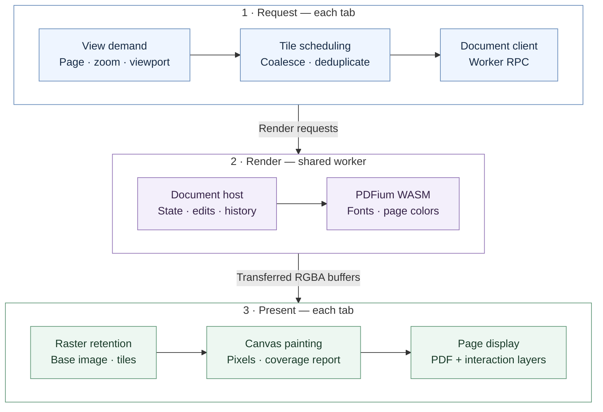

# Rendering design

This is the sole authoritative design document for the rendering pipeline.
Update it with changes to rendering ownership, transport, scheduling, caches,
or runtime lifecycle. Keep local implementation details in code comments.

[User guide](README.md) · [Glossary](GLOSSARY.md) · [Development](AGENTS.md)

## Pipeline

Base rasters and tiles use raw RGBA transferred from the worker to Canvas.
EmbedPDF's TileManager and RasterStore handle scheduling, deduplication, LRU,
and retention; React paints and reports presentation. Annotation/form assets
and image exports use the SDK's encoded-image APIs.

The diagram follows a render request that needs new pixels. Cached rasters stay
in the tab; edits invalidate affected rendering, and Canvas reports presented
coverage before older tiles are released. The request and presentation sections
belong to the same tab. A dedicated worker replaces the shared worker when needed.

Saving is a separate path: the host prepares a complete PDF write plan, the
platform writer writes the file, and its result confirms the saved revision.

## Tiles and motion

| Setting | Value |
| --- | --- |
| Tile edge / bleed | 768 / 2 pixels |
| Resolution levels | 0.5–128 device pixels per PDF point, spaced by √2 |
| Raster cache | 32 MiB per tab |
| Normal mode | Two concurrent tile requests per controller; coalesce demand in fixed 60 ms windows |
| Energy saving | One concurrent request; DPR 1.25; resume after 120 ms without camera changes |

Painted tiles remain during motion until replacement coverage is presented.
Active tiles retain raster references independently of cache eviction, so the
cache budget does not cap active pixels or Canvas memory. Unmounting releases
canvas backing stores.

## Worker lifecycle

A SharedWorker owns PDFium and shared document state. Without SharedWorker or
Web Locks, a dedicated worker is used. Tabs keep separate rendering caches.
The worker shares a 64 MiB parsed-page cache and a 32 MiB decoded-image cache
across documents; these budgets do not cap the WASM heap.

After the last document closes and pending saves/drafts finish, a 10-second grace
period precedes native runtime teardown. Reopening cancels teardown; opening
after teardown initializes a new runtime through the existing tab ports.
Shutdown explicitly cancels EmbedPDF 3.0's residual page-residency timer.

## SDK patch

`patches/@embedpdf__plugin-render@3.0.0.patch` adds raw viewer transport while
preserving encoded exports. It fixes cache byte accounting, eviction after
consumer release, late canceled results, and view cleanup. Revalidate the patch
and runtime cleanup when upgrading EmbedPDF.

`tests/render-tiles.test.mjs` covers installed ESM/CJS buffer identity, request
merging, pan reuse, zoom retention, and cleanup. `tests/canvas-painter.test.mjs`
checks that tightly packed pixels reach ImageData in the original buffer.
`putImageData` still copies pixels into the Canvas backing store.

## Measurement limits

`tools/diagnostics/compare-canvas-rendering.mjs` compares raw RGBA and encoded-image paths: warmup, 10 alternating
samples per size, exact pixel equality including rotation/crop, and median
worker/RPC and presentation-submission times.
It excludes GPU compositing, pixel-readback timing, and RSS; it does not measure
viewer scrolling. BMP adds only 66 bytes to transfer size, so raw transport saves
encoding, copying, and decoding work rather than bandwidth.
