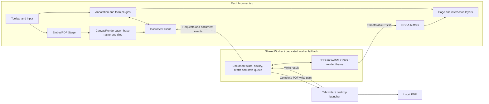

# Rendering implementation and checks

[User guide](../README.md) · [Glossary](../GLOSSARY.md)

### Canvas rendering and regression checks

Page viewing uses raw RGBA → transferable worker buffer → Canvas for both the
base raster and tiles. There is no viewer mode switch or BMP fallback. EmbedPDF's
TileManager and RasterStore own scheduling, deduplication, LRU and retention;
the React layer only paints and reports presentation. Tiles use 768-pixel edges
with 2-pixel bleed and sqrt(2)-spaced resolution levels (0.5–128 device pixels
per PDF point). Active tiles retain their raster references independently of
cache eviction; the cache budget does not cap active pixels or Canvas memory.
The viewer uses a 32 MiB raster cache, two concurrent tile
requests per render controller, and a 60 ms fixed window that coalesces the newest
demand during motion. This is a tile request limit, not a global Worker byte
budget. Old tiles remain until replacement coverage is presented.
Unmount releases canvas backing stores. Annotation/form image assets and image
exports retain the SDK's encoded-image APIs.

`patches/@embedpdf__plugin-render@3.0.0.patch` adds an opt-in raw transport to the
SDK viewer sources while preserving those export APIs. It also fixes cache byte
accounting, eviction after consumer release, late canceled results, and view
cleanup. The patch is pinned in pnpm; revalidate it when upgrading EmbedPDF.
`tests/render-tiles.test.mjs` tests the installed ESM and CJS implementations,
including buffer identity, request merging, pan reuse, zoom retention and cleanup.
`tests/canvas-painter.test.mjs` asserts tightly packed pixels reach ImageData using
the original buffer. These assertions do not measure browser/GPU allocation:
`putImageData` still copies pixels into the canvas backing store.

With Vite running, use the existing global Playwright and system Chrome:

```sh
node tools/diagnostics/compare-canvas-rendering.mjs
node tests/browser/check-canvas-viewer.mjs
node tests/browser/check-shared-viewer.mjs
```

Set `PDF_TEST_URL` to override `http://127.0.0.1:5173`, and `PDF_BENCH_OUTPUT` to
save benchmark JSON. The benchmark warms both paths, alternates 10 samples per
size, checks exact pixel equality (including rotation/crop), and reports median
worker/RPC and presentation-submission times. It excludes pixel readback, GPU
compositing and RSS; it is not a full-viewer scrolling benchmark. Transfer volume
is almost identical: BMP adds 66 header bytes; the saving is encoding/copying and
image decoding, not compression.

Both modes retain painted tiles during camera motion. Normal mode coalesces the
latest demand in fixed 60 ms windows and continues rendering during motion, with
two concurrent tile requests. Energy saving pauses new work until 120 ms without
camera changes, uses one concurrent request and fixes DPR at 1.25. It has no
additional scheduling delay after settling. Settings diagnostics
refresh every two seconds while the dialog is open. Temporary memory tracing has
been removed. `node tests/browser/check-energy-motion.mjs` verifies retention and resume
in both modes against the local preview.

## Rendering and Worker pipeline

EmbedPDF 3 manages the viewport and progressive page rendering. A SharedWorker
owns PDFium and shared document state; environments without SharedWorker or Web
Locks fall back to a dedicated worker. Each tab keeps its own rendering cache.
The worker shares a 64 MiB parsed-page cache and a 32 MiB decoded-image cache
across documents. These are cache budgets, not a hard limit on the WASM heap.
After the last document closes and outstanding saves/drafts finish, a 10-second
idle grace period releases the native runtime. Connected tabs retain their ports;
a later open initializes a fresh runtime. Opening during the grace period cancels
teardown. EmbedPDF 3.0's residual page-residency timer is explicitly canceled on
shutdown; revisit this version-specific cleanup on SDK upgrades.

Against Vite dev, `node tests/browser/check-runtime-idle.mjs` verifies shared-tab
ownership, grace-period reopen, idle destruction and rendering after reinitialization.



